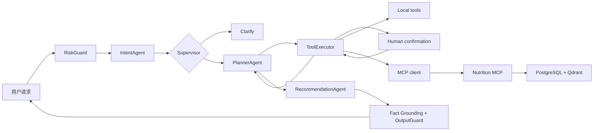

# NutriPilot

NutriPilot 是一个面向求职展示的多智能体个性化饮食决策系统。它使用 LangGraph 编排 Intent、Planner、Recommendation 三个职责独立的 Worker Agent，通过结构化工具规划、MCP 餐食检索、用户画像、人工确认、安全守卫、Checkpoint、Trace 和版本化评测完成可控的饮食决策链路。

## 核心特点

- **Supervisor-Worker Multi-Agent**：LangGraph 显式控制路由、循环、中断与恢复，Agent 通过共享状态协作。
- **结构化工具规划**：Planner 只能选择当前意图白名单内的工具，并接收真实工具参数 Schema。
- **MCP 工具边界**：餐食检索、营养查询和膳食指南通过官方 MCP SDK 与 Streamable HTTP 暴露。
- **混合检索**：结构化过滤、向量召回、RRF 融合和重排序；展示模式接线 BGE-M3、BGE Reranker 与 Qdrant。
- **确定性安全**：过敏和忌口在工具参数、检索候选、计划写入和最终输出多个阶段强制检查。
- **Human-in-the-loop**：画像更新和计划写入必须由用户确认，并支持 Checkpoint 恢复。
- **持久会话执行**：持久化模式将任务交给独立 Worker；切页、切会话、刷新和关页不取消生成，支持事件重播和进程重启恢复。
- **事实落地**：菜名、营养值、引用和餐食解释由工具记录核实；画像过敏原与餐食过敏原分别标注。
- **可观测与评测**：记录节点、工具、模型、Token、Prompt 版本和 Fallback；Fake 与真实模型评测明确分离。

## 架构



## 获取项目

```powershell
git clone https://github.com/roman1115/nutripilot.git
cd nutripilot
```

将上面的地址替换为实际 GitHub 仓库地址。如果仓库名称不是 `nutripilot`，同步替换 `cd` 后面的目录名。

## 运行模式

### 1. 离线演示模式

无需 API Key、Docker 或模型下载，使用：

- `FakeModelGateway`
- Hashing Embedder
- Lexical Reranker
- 内存数据与 Checkpoint
- 进程内 MCP Transport

macOS / Linux 首次安装依赖（需要 Node.js 22.12+；Python 3.12 由 uv 自动准备）：

```bash
python3 -m pip install --target .runtime/tools uv
.runtime/tools/bin/uv sync --python 3.12 --extra dev --frozen
npm --prefix web ci
```

启动：

```bash
sh scripts/start_demo.sh
```

终端显示就绪后，访问 `http://127.0.0.1:5173`，按 `Ctrl+C` 同时停止前后端。日志保存在 `.runtime/`。端口被占用时可指定其他端口，前端 API 地址和 CORS 会自动同步：

```bash
sh scripts/start_demo.sh --api-port 8001 --web-port 5174
```

演示模式的画像、餐单、反馈和图状态保存在内存中，停止服务后会清空。
离线模式的聊天任务、消息和图状态随 API 进程退出而丢失；Trace 和评测报告保存到
`.runtime/demo-observability.sqlite3`。旧版本已保存的消息仍可导入查看，
但不能恢复丢失的业务数据和图状态；需要重启恢复时使用下面的持久化模式。

Windows：

```powershell
.\scripts\start_demo.ps1
```

启动后访问：

- Web：<http://localhost:5173>
- API 文档：<http://localhost:8000/docs>

停止：

```powershell
.\scripts\stop_demo.ps1
```

该模式用于学习、开发和稳定回归。页面会明确显示“规则演示”，其评测分数不能作为真实大模型指标。
日期按 `USER_TIMEZONE` 解析，默认为 `America/Los_Angeles`；跨时区部署时请设为用户所在的 IANA 时区。

### 2. 持久化演示模式

需要 Docker Desktop，无需模型 API Key 或下载 BGE。复用同一启动器，将对话保持为 Fake，
业务数据与 Checkpoint 改用 PostgreSQL，幂等控制改用 Redis，检索使用独立 HTTP MCP 与 Qdrant：

```bash
USER_TIMEZONE=Asia/Shanghai sh scripts/start_demo.sh --mode persistent --api-port 8005 --web-port 5177 --mcp-port 8011
```

Windows 可使用 `.venv\Scripts\python.exe scripts/demo_launcher.py --mode persistent --foreground`。
启动器会等待三个基础服务就绪、执行 Alembic、迁移菜谱并预热 MCP；前台运行时按 `Ctrl+C` 停止应用进程，
数据库容器和数据卷保留。不要删除数据卷来停止服务。已有基础服务可加 `--no-infrastructure`，仍会执行迁移。

此模式下画像、餐单、反馈、会话消息、任务、事件和图状态保存在 PostgreSQL；
Trace 和评测报告默认仍位于 `.runtime/persistent-observability.sqlite3`，也需要保留该文件。
启动时会备份并导入旧 SQLite 消息，原文件不删除。页面仍显示规则演示，不能作为真实 Qwen 效果。
100 道菜谱参与推荐，旧 18 条只供历史查询。普通与 BGE 模式分别使用 `meal_search`、
`meal_search_bge_m3`，启动时只迁移本模式的索引。

2026-10-29 已在既有数据库上验证迁移，并实际重启 API、MCP、PostgreSQL、Redis 与 Qdrant，
数据快照保持一致。验收、备份和重跑说明见 [真实持久化验收](docs/persistence-validation-2026-10-29.md)。

### 3. 真实求职展示模式

前置条件：Docker Desktop、DashScope API Key，以及首次下载 BGE 模型所需的网络和磁盘空间。

```powershell
Copy-Item .env.showcase.example .env
# 编辑 .env，填写 MODEL_API_KEY 和随机 MCP_INTERNAL_TOKEN
.\scripts\start_showcase.ps1
```

该模式强制使用：

- `qwen-plus`，失败时可切换 `qwen-turbo`
- BGE-M3 Embedding
- BGE Reranker v2-M3
- PostgreSQL 业务数据与 LangGraph Checkpoint
- Redis 幂等控制
- Qdrant 向量索引
- 独立 Streamable HTTP MCP 服务

本地 `scripts/start_real.sh` / `scripts/start_real.ps1` 启动前会向当前配置的主模型发送一次小量真实请求，
不重试、不切换备用模型；额度、权限或凭据检查失败时，在加载 BGE、启动新服务和迁移数据库前退出。
批量验收脚本同样先检查模型可用性。请求会使用提供方额度，是否允许付费由账号控制台设置决定。

单独检查模型调用权限：

```sh
.venv/bin/python scripts/verify_showcase.py --probe-only
```

该命令使用 `.env` 中的真实模型配置，与演示模式无关；检查通过返回退出码 0，
失败返回非零并保存 `.runtime/model-probe.json`。不记录密钥；提供方未返回 Token 用量时保存为未知。
2026-10-29 的实际检查仍受 `AllocationQuota.FreeTierOnly` 限制，
2026-10-29 额度恢复后已完成迁移后的真实 Qwen/BGE 验收：推荐 14/14、扩展 8/8、
浏览器换菜及确认保存通过，无模型降级。这是固定小样本功能回归，
失败历史和实际 Token 见 [真实模型验收](docs/qwen-catalog-validation-2026-10-29.md)。
本机真实入口为 `http://127.0.0.1:5178`（API 8006、MCP 8012）。

### 持久会话与并发

`persistent` 和 `real` 启动器均启动一个独立聊天 Worker。每个部署队列默认全局同时执行 4 个任务、
每用户 3 个、同会话 1 个；其余任务排队，每用户最多接收 20 个未结束任务。
这一个执行进程与图中的三个 Worker Agent 职责不同，三个 Agent 仍保留。
API、Worker 必须使用相同的 `CHAT_QUEUE`、数据库和 `RUN_STORE_PATH`；
本机 Fake 与真实入口使用不同队列，各有自己的 Worker。

- 浏览器只提交任务和订阅事件；切页、切会话、刷新、关页和断网均不触发服务端取消。
- 新建会话可与已有会话并行；同会话的多标签页会同步任务状态，主动停止只针对指定任务。
- API 重启不影响独立 Worker；Worker 重启后从已落盘的节点检查点继续。
- 任务默认最多执行两次（首次加一次恢复），总时限与 Token 预算不因恢复重置；排队等待不占执行时限。
- 崩溃时未完成的模型调用可能重发并产生额外 Token；恢复以节点为边界，不承诺从半段回答接续。
- 确认和写入继续校验用户、预览版本与幂等键；已完成的数据写入不会被“停止”撤销。

Docker Compose 已包含 `worker`，并设置退出后重启。本地后台进程意外退出时，需要重新启动该进程，
任务才会恢复；机器或基础设施停机期间不会继续生成。
离线 `demo` 使用 API 内嵌执行器，只支持浏览器断开后的继续执行，不具备服务进程重启恢复能力。
配置见 `.env.example` 的 `CHAT_*`；架构与实际验收见
[持久会话改造记录](docs/chat-durable-execution-2026-10-30.md)。

脚本会执行运行模式检查和真实请求冒烟测试。如果任何组件仍是 Fake/内存模式，验收会失败。

停止：

```powershell
.\scripts\stop_showcase.ps1
```

## 手动开发启动

后端：

```powershell
.\.venv\Scripts\python.exe -m uvicorn apps.api.main:app --host 127.0.0.1 --port 8000
```

前端（另一个 PowerShell）：

```powershell
npm --prefix web run dev -- --host 127.0.0.1 --port 5173
```

手动使用 PostgreSQL 模式时，还需在相同环境中另开终端运行：

```bash
APP_MODE=docker .venv/bin/python -m nutripilot.worker
```

API 同样设置 `APP_MODE=docker`，并与 Worker 共用数据库、队列、MCP 连接和 Trace 路径。
只启动 API 时仍可保存排队任务，页面显示“等待任务执行器”。

## 质量检查

```powershell
.\.venv\Scripts\python.exe -m ruff check src apps tests scripts migrations
.\.venv\Scripts\python.exe -m mypy -p nutripilot -p apps
.\.venv\Scripts\python.exe -m pytest --cov=nutripilot --cov=apps
npm --prefix web run typecheck
npm --prefix web run build
```

Fake Model 回归：

```powershell
.\.venv\Scripts\python.exe -m nutripilot.evaluation.cli --label fake-model-baseline-v2
```

历史 `nutripilot-core-v2` 的 Fake 回归基线为 `60/60`。当前 `nutripilot-core-v3-2026-10-29` 已按来源菜谱和整菜餐单契约运行，Fake 回归为 `60/60`；只证明固定场景的流程、工具契约和安全规则，不能写成 Qwen 准确率。真实展示模式应单独保存真实模型报告，并记录模型名、Prompt 版本、Token、延迟和失败用例。

100 道菜谱另有固定推荐场景 `evals/datasets/catalog-recommendations.json`，覆盖点菜、筛选、换菜及整菜营养查询。2026-10-29 的 Fake/BGE 历史结果见 [推荐链路验收](docs/catalog-recommendations-2026-10-29.md)；额度恢复后的真实 Qwen/BGE 最终结果见 [迁移后真实模型验收](docs/qwen-catalog-validation-2026-10-29.md)。

旧 18 条数据退役、菜品餐单、历史兼容及当前部署待验事项见 [退役迁移验收](docs/catalog-retirement-2026-10-29.md)。

2026-10-30 已接入独立做法意图和 `get_recipe`：支持指定菜名及“第二道怎么做”，
原始用量、步骤和来源由 MCP 返回；歧义先澄清，不用推荐代替做法。
推荐卡片采用简短有据的说明，完整营养计算说明可展开查看。
真实 Qwen 与浏览器验收和重跑命令见 [做法查询验收](docs/recipe-chat-fix-2026-10-30.md)。

## 推荐演示流程

1. 在侧栏确认显示“真实模型”、`qwen-plus`、`postgresql` 和 `streamable-http`。
2. 在用户画像中填写目标、城市、热量目标、过敏原和忌口。
3. 提问“推荐一份清淡、高蛋白、600 千卡以内的午餐”。
4. 打开 Trace，说明三个 Worker Agent、工具 Schema、MCP 调用和事实引用。
5. 提问“制定一周三餐餐单”，核对日期、餐次、菜品与整菜营养范围，换一批后确认保存。
6. 提交不喜欢反馈，再次推荐并观察候选排除。
7. 展示评测页，并明确区分 Fake 回归基线和真实模型结果。

## 诚实边界

- 当前种子库是小规模、可人工审查的演示语料，不是商业级营养数据库。
- 18 条旧演示餐食已退役，仅保留历史餐单和反馈引用。新推荐、营养查询及餐单统一使用 100 道来源菜谱。
- 已导入 7,802 条食品/食材营养记录（7,793 条 USDA、8 条日本官方成分表、1 条 CJ 味精数据）和 100 道来源菜谱；100 道均已按原文与显式项目假设接通计算和检索，待整理为 0。批量草稿工具可复用食材别名与换算规则，草稿核对后才能发布。新增菜谱不等于完整一餐，估算不等于实测，详见 [两库数据说明](data/README.md)。
- 系统提供一般饮食信息，不进行疾病诊断、处方或医疗治疗建议。
- 餐单只安排菜品，营养按所选整道菜合计，不推断人数或个人摄入，不评定每日营养达标。价格、准备时间及部分饮食标签未知，严格限定这些条件时可能没有候选。
- CrewAI、AutoGen、AgentScope 不是缺失项；本项目选择 LangGraph 作为唯一编排器。
- Kafka、Kubernetes 和大规模微服务拆分不属于个人求职项目的必要范围。
- 未提供真实 API Key 或未运行真实验收时，不应声称项目已经取得真实 Qwen 准确率。

详细设计基线见 [项目设计与实现方案.md](项目设计与实现方案.md)。

当前项目进度、已知边界和下一步见 [CURRENT_STATUS.md](CURRENT_STATUS.md)；仓库协作约定见 [AGENTS.md](AGENTS.md)。

本地运行验证的实际结果与边界见 [2026-10-21 链路验收记录](docs/local-chain-validation-2026-10-21.md)。

真实 Qwen、BGE 与外部基础设施的小样本验收结果见 [2026-10-21 真实模型验收](docs/real-model-validation-2026-10-21.md)。

本轮解释准确性、查询容错、预算取消、持久化、访问控制及一键启动说明见
[2026-10-21 可靠性修复记录](docs/reliability-improvements-2026-10-21.md)。

每日营养目标、餐单去重、确认预览、完整会话历史与备份清理说明见
[2026-10-21 连续使用与餐单质量完善](docs/completeness-improvements-2026-10-21.md)。
