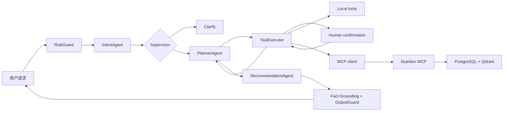

# NutriPilot

NutriPilot 是一个面向求职展示的多智能体个性化饮食决策系统。它使用 LangGraph 编排 Intent、Planner、Recommendation 三个职责独立的 Worker Agent，通过结构化工具规划、MCP 餐食检索、用户画像、人工确认、安全守卫、Checkpoint、Trace 和版本化评测完成可控的饮食决策链路。

## 核心特点

- **Supervisor-Worker Multi-Agent**：LangGraph 显式控制路由、循环、中断与恢复，Agent 通过共享状态协作。
- **结构化工具规划**：Planner 只能选择当前意图白名单内的工具，并接收真实工具参数 Schema。
- **MCP 工具边界**：餐食检索、营养查询和膳食指南通过官方 MCP SDK 与 Streamable HTTP 暴露。
- **混合检索**：结构化过滤、向量召回、RRF 融合和重排序；展示模式接线 BGE-M3、BGE Reranker 与 Qdrant。
- **确定性安全**：过敏和忌口在工具参数、检索候选、计划写入和最终输出多个阶段强制检查。
- **Human-in-the-loop**：画像更新和计划写入必须由用户确认，并支持 Checkpoint 恢复。
- **事实落地**：菜名、营养值、引用和餐食解释由工具记录核实；画像过敏原与餐食过敏原分别标注。
- **可观测与评测**：记录节点、工具、模型、Token、Prompt 版本和 Fallback；Fake 与真实模型评测明确分离。

## 架构



## 获取项目

```powershell
git clone https://github.com/roman1115/nutripilot.git
cd nutripilot
```

将上面的地址替换为实际 GitHub 仓库地址。如果仓库名称不是 `nutripilot`，同步替换 `cd` 后面的目录名。

## 两种运行模式

### 1. 离线演示模式

无需 API Key、Docker 或模型下载，使用：

- `FakeModelGateway`
- Hashing Embedder
- Lexical Reranker
- 内存数据与 Checkpoint
- 进程内 MCP Transport

macOS / Linux 首次安装依赖（需要 Node.js 22.12+；Python 3.12 由 uv 自动准备）：

```bash
python3 -m pip install --target .runtime/tools uv
.runtime/tools/bin/uv sync --python 3.12 --extra dev --frozen
npm --prefix web ci
```

启动：

```bash
sh scripts/start_demo.sh
```

终端显示就绪后，访问 `http://127.0.0.1:5173`，按 `Ctrl+C` 同时停止前后端。日志保存在 `.runtime/`。端口被占用时可指定其他端口，前端 API 地址和 CORS 会自动同步：

```bash
sh scripts/start_demo.sh --api-port 8001 --web-port 5174
```

演示模式的业务数据和会话保存在内存中，停止服务后会清空。启动脚本将 Trace 和评测报告保存到 `.runtime/demo-observability.sqlite3`。

Windows：

```powershell
.\scripts\start_demo.ps1
```

启动后访问：

- Web：<http://localhost:5173>
- API 文档：<http://localhost:8000/docs>

停止：

```powershell
.\scripts\stop_demo.ps1
```

该模式用于学习、开发和稳定回归。页面会明确显示“规则演示”，其评测分数不能作为真实大模型指标。

### 2. 真实求职展示模式

前置条件：Docker Desktop、DashScope API Key，以及首次下载 BGE 模型所需的网络和磁盘空间。

```powershell
Copy-Item .env.showcase.example .env
# 编辑 .env，填写 MODEL_API_KEY 和随机 MCP_INTERNAL_TOKEN
.\scripts\start_showcase.ps1
```

该模式强制使用：

- `qwen-plus`，失败时可切换 `qwen-turbo`
- BGE-M3 Embedding
- BGE Reranker v2-M3
- PostgreSQL 业务数据与 LangGraph Checkpoint
- Redis 幂等控制
- Qdrant 向量索引
- 独立 Streamable HTTP MCP 服务

脚本会执行运行模式检查和真实请求冒烟测试。如果任何组件仍是 Fake/内存模式，验收会失败。

停止：

```powershell
.\scripts\stop_showcase.ps1
```

## 手动开发启动

后端：

```powershell
.\.venv\Scripts\python.exe -m uvicorn apps.api.main:app --host 127.0.0.1 --port 8000
```

前端（另一个 PowerShell）：

```powershell
npm --prefix web run dev -- --host 127.0.0.1 --port 5173
```

## 质量检查

```powershell
.\.venv\Scripts\python.exe -m ruff check src apps tests scripts migrations
.\.venv\Scripts\python.exe -m mypy -p nutripilot -p apps
.\.venv\Scripts\python.exe -m pytest --cov=nutripilot --cov=apps
npm --prefix web run typecheck
npm --prefix web run build
```

Fake Model 回归：

```powershell
.\.venv\Scripts\python.exe -m nutripilot.evaluation.cli --label fake-model-baseline-v2
```

当前 `nutripilot-core-v2` 的 Fake 确定性回归基线为 `60/60`；它只证明流程、工具契约和安全规则没有回归，不能写成 Qwen 准确率。真实展示模式应单独保存真实模型报告，并记录模型名、Prompt 版本、Token、延迟和失败用例。

## 推荐演示流程

1. 在侧栏确认显示“真实模型”、`qwen-plus`、`postgresql` 和 `streamable-http`。
2. 在用户画像中填写目标、城市、热量目标、过敏原和忌口。
3. 提问“推荐一份清淡、高蛋白、600 千卡以内的午餐”。
4. 打开 Trace，说明三个 Worker Agent、工具 Schema、MCP 调用和事实引用。
5. 提问“制定一周三餐饮食计划”，展示完整性校验和人工确认。
6. 提交不喜欢反馈，再次推荐并观察候选排除。
7. 展示评测页，并明确区分 Fake 回归基线和真实模型结果。

## 诚实边界

- 当前种子库是小规模、可人工审查的演示语料，不是商业级营养数据库。
- 系统提供一般饮食信息，不进行疾病诊断、处方或医疗治疗建议。
- CrewAI、AutoGen、AgentScope 不是缺失项；本项目选择 LangGraph 作为唯一编排器。
- Kafka、Kubernetes 和大规模微服务拆分不属于个人求职项目的必要范围。
- 未提供真实 API Key 或未运行真实验收时，不应声称项目已经取得真实 Qwen 准确率。

详细设计基线见 [项目设计与实现方案.md](项目设计与实现方案.md)。

本地运行验证的实际结果与边界见 [2026-10-21 链路验收记录](docs/local-chain-validation-2026-10-21.md)。

真实 Qwen、BGE 与外部基础设施的小样本验收结果见 [2026-10-21 真实模型验收](docs/real-model-validation-2026-10-21.md)。

本轮解释准确性、查询容错、预算取消、持久化、访问控制及一键启动说明见
[2026-10-21 可靠性修复记录](docs/reliability-improvements-2026-10-21.md)。

每日营养目标、餐单去重、确认预览、完整会话历史与备份清理说明见
[2026-10-21 连续使用与餐单质量完善](docs/completeness-improvements-2026-10-21.md)。
