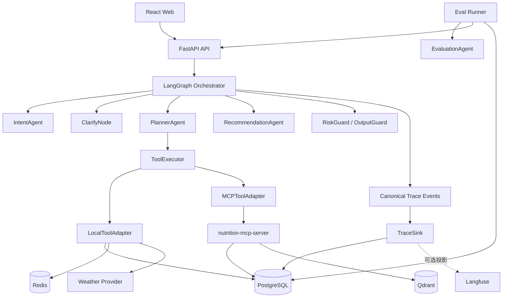
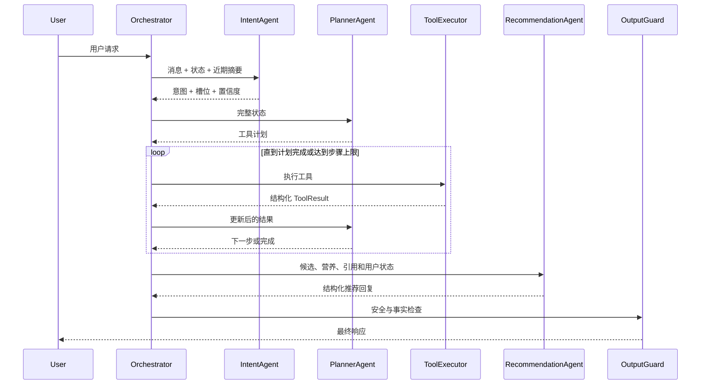

# NutriPilot：多智能体个性化饮食决策系统

> 文档状态：最终求职版技术基线  
> 用途：作为后续架构设计、编码实现、测试验收、学习复盘和简历整理的统一参考。  
> 原则：后续实现默认遵循本文档；如需改变核心技术或范围，应先更新本文档并记录原因。

## 0. 当前实现状态（v1.0.0）

本文档同时保留设计依据与可选扩展，但简历和面试只应描述下面已经落地的能力：

- 已实现 LangGraph Supervisor-Worker、多轮状态、条件路由、循环、Checkpoint 与人工确认；
- 已实现 Intent、Planner、Recommendation 三个模型 Worker，以及确定性的工具、安全和事实落地节点；
- 已实现工具 Schema 白名单、统一 ToolExecutor、进程内/Streamable HTTP 两种 MCP 模式；
- 已实现 Hashing/BGE Embedding、Lexical/BGE Reranker、结构化过滤、融合召回与 Qdrant 适配；
- 已实现用户画像、计划、反馈回流、过敏与忌口多层校验、Trace、异步评测和 React 工作台；
- 已提供 Fake 离线演示，以及 Qwen + PostgreSQL + Redis + Qdrant + HTTP MCP 的 Docker Compose 展示配置。

当前不能作为“已完成能力”写入简历的内容：Langfuse Adapter、用户经验的语义长期记忆、真实天气 API、生产级海量营养数据库。天气工具目前使用可替换的归一化 Provider；长期偏好由 PostgreSQL 用户画像与显式反馈承载。由于当前机器未配置 Docker 和 DashScope API Key，真实 Qwen/BGE/外部基础设施模式属于“代码与配置已接通、待具备环境后验收”，不能宣称已经取得真实模型准确率或延迟指标。

## 1. 项目定位

### 1.1 项目名称

**NutriPilot：可观测、可评估的多智能体个性化饮食决策系统**

### 1.2 项目介绍

NutriPilot 面向用户“不知道吃什么”的日常决策场景，结合餐次、口味、心情、生活场景、健康目标、过敏原及历史偏好，通过多轮对话补全需求，并调用餐食检索、营养查询、天气信息、用户画像、饮食计划和反馈记录等工具，生成有依据、可执行的个性化饮食方案。

系统采用“LangGraph 确定性 Supervisor + 三个模型 Worker”的多 Agent 架构。LangGraph 本身就是唯一编排器，负责路由、循环、中断和恢复；IntentAgent、PlannerAgent、RecommendationAgent 分别负责理解、规划和生成。槽位澄清、工具执行和安全校验作为确定性节点或服务运行，EvaluationAgent 只用于离线评估。系统同时具备持久化状态、结构化用户画像、模型及工具异常降级、健康风险控制、全链路 Trace、离线评估及用户反馈回流能力。

项目目标不是实现一个只会生成文本的聊天机器人，而是实现一个能够：

- 理解用户目标并维护跨轮状态；
- 在信息不足时主动澄清；
- 规划并调用真实工具完成任务；
- 基于检索结果和业务规则生成有依据的建议；
- 在模型或工具异常时继续提供受控响应；
- 通过 Trace 和评测数据证明系统效果。

### 1.3 简历版项目简介

> 面向日常饮食决策场景，基于 LangGraph 构建 Supervisor-Worker 多智能体系统，通过意图识别、槽位澄清、任务规划、工具调用、检索重排和安全校验完成个性化饮食推荐；设计用户画像、Checkpoint、反馈回流、全链路 Trace、异常 Fallback 和离线评估闭环，使 Agent 执行过程可恢复、可观测、可评估。

注意：简历中的准确率、延迟、Token 成本、Fallback 率等量化结果，必须在项目完成并运行评测后填写，禁止预先编造。

## 2. 求职目标与项目价值

本项目面向以下岗位：

- Agent 开发工程师；
- 大模型应用开发工程师；
- AI 后端工程师；
- RAG / 智能问答应用工程师；
- Python 后端与大模型应用结合岗位。

项目重点证明以下能力：

1. 使用 LangGraph 设计显式、可恢复的 Agent 状态图；
2. 设计真实 Tool Calling，而不是仅调用一次大模型；
3. 构建职责清晰的多 Agent 协作模式；
4. 管理多轮对话、结构化状态、用户画像和反馈记忆；
5. 实现模型、工具、MCP 和检索链路的可靠性治理；
6. 建立 Agent Trace、离线评估及反馈迭代闭环；
7. 通过测试、容器化和文档完成工程交付。

## 3. 范围与边界

### 3.1 最终求职版必须包含

- Supervisor-Worker 多 Agent 协作；
- LangGraph 状态机、条件路由、循环和 Checkpoint；
- 意图识别、槽位抽取和多轮澄清；
- Planner Agent 与真实 Tool Calling；
- 本地工具和 MCP 工具的统一调用；
- PostgreSQL、Redis、Qdrant 数据体系；
- 结构化偏好、会话 Checkpoint 和反馈记忆；
- 餐食检索、过滤、融合和 Rerank；
- 模型超时、非法输出、工具失败和检索无结果的 Fallback；
- 过敏原、健康风险、提示词注入和写操作权限控制；
- 自研 Trace 事件、模型/工具耗时、Token 与 Prompt 版本记录；
- 离线评测集、批量评估及报告；
- React 演示页面；
- Docker Compose 一键启动；
- 单元测试、集成测试、异常测试和学习文档。

### 3.2 明确不做

- 不实现医疗诊断、治疗方案或药物建议；
- 不将项目拆成大量微服务；
- 不引入 Kafka、Kubernetes 或服务网格；
- 不同时使用 AgentScope、CrewAI、AutoGen 等多套 Agent 框架；
- 不将每个普通函数或确定性规则包装成 Agent；
- 不实现多个 Agent 自由群聊或无边界自主协商；
- 不训练基础大模型，不将 LoRA 微调作为主线；
- 不依赖无法稳定访问的第三方 MCP 服务；
- 不使用没有评测依据的量化指标。

### 3.3 架构原则

- **确定性流程优先**：状态迁移、安全规则和写操作权限由代码控制；
- **LLM 只做适合推理的工作**：意图理解、规划、自然语言生成和主观质量评价；
- **结构化优先**：Agent 输出必须通过 Pydantic / JSON Schema 校验；
- **最小权限**：每个 Agent 只能访问其职责所需的工具；
- **先可观测再优化**：任何性能或效果优化都应有 Trace 和评测依据；
- **失败是正常分支**：超时、解析失败、空结果和连接中断必须有明确处理路径；
- **模块化单体优先**：主系统保持单体部署，但模块边界清晰；
- **协议扩展受控**：仅使用一个 MCP Server 展示标准化工具接入，不让 MCP 主导业务架构。

## 4. 最终技术选型

| 层级 | 技术 | 职责与选择原因 |
|---|---|---|
| 语言 | Python 3.12 | Agent 生态完整，符合主要目标岗位 |
| 包管理 | uv | 管理虚拟环境、依赖锁定和运行命令 |
| API 服务 | FastAPI | 异步接口、SSE 流式响应和自动 OpenAPI |
| 数据模型 | Pydantic v2 | AgentState、工具参数和模型结构化输出校验 |
| Agent 编排 | LangGraph | 显式状态图、条件路由、循环、Checkpoint 和人工确认 |
| 模型 SDK | OpenAI Python SDK 兼容接口 | 默认接入通义千问，同时保留模型切换能力 |
| 模型网关 | 轻量自研 ModelGateway | 复用官方 SDK，仅统一模型选择、超时、分类重试、备用模型、结构化输出、Token 与成本统计 |
| 默认 LLM | 通义千问，具体模型通过配置决定 | 意图识别、任务规划、回复生成及 LLM Judge |
| 业务数据库 | PostgreSQL 16 | 用户、餐食、营养、计划、反馈、Trace 和评测数据 |
| ORM | SQLAlchemy 2 | 数据访问和事务管理 |
| 数据库迁移 | Alembic | 维护可复现的数据结构版本 |
| 状态持久化 | LangGraph PostgreSQL Checkpointer | 会话状态保存、中断恢复和多实例一致性基础 |
| 缓存与并发 | Redis 7 | 幂等键、限流、分布式锁和短期结果缓存 |
| 向量数据库 | Qdrant | 饮食知识和语义记忆的向量检索及 Payload 过滤 |
| Embedding | BGE-M3 | 中文及多语言语义向量化 |
| Reranker | BGE-Reranker-v2-M3 | 对候选餐食和知识片段进行精排 |
| MCP | 官方 Python MCP SDK | 实现一个受控的营养查询 MCP Server |
| MCP 传输 | Streamable HTTP | 适合 Docker Compose 下的独立进程调用 |
| 可观测性 | 自研 TraceRecorder | 统一记录节点、工具、模型、Token、Prompt 版本、耗时、Fallback 与确认事件；Langfuse 仅为未落地的可选扩展 |
| 日志 | structlog | 输出带 trace_id、thread_id 的结构化 JSON 日志 |
| 评估 | 自研 Eval Runner + 规则评分 + LLM Judge | 保留指标定义和评测流程的可解释性 |
| 后端测试 | pytest + pytest-asyncio + respx | 单元、异步、模型及 HTTP Mock 测试 |
| 前端 | React + TypeScript + Vite | 对话、计划、Trace 和评估报告演示 |
| 部署 | Docker Compose | 一键启动 API、Web、数据库、缓存、向量库和 MCP |
| 代码质量 | Ruff + mypy + pre-commit | 格式、静态类型和提交前检查 |
| CI | GitHub Actions | 自动执行检查、测试和镜像构建 |

具体第三方包版本在开始编码时选择当时的稳定兼容版本，并由 `uv.lock` 固定。未经验证不在本文档中预写易过时的框架小版本号。

## 5. 总体架构



### 5.1 部署边界

主业务采用模块化单体。Docker Compose 中运行以下进程：

1. `api`：FastAPI、LangGraph、多 Agent、业务服务和本地工具；
2. `web`：React 前端；
3. `nutrition-mcp`：唯一的 MCP 工具服务；
4. `postgres`：业务、状态、Trace 和评测数据；
5. `redis`：缓存、锁和限流；
6. `qdrant`：饮食知识和语义记忆向量；
7. Langfuse 通过 TraceSink Adapter 可选接入，项目在没有 Langfuse 凭证时仍能使用 PostgreSQL 审计投影完整运行。

`nutrition-mcp` 是为了展示 MCP 协议和工具解耦而存在的受控边界，不代表采用全面微服务架构。LangGraph 就是系统唯一的 Orchestrator，不再额外实现第二套调度服务。

## 6. 多 Agent 协作设计

### 6.1 Agent 与确定性组件

| 组件 | 是否调用 LLM | 核心职责 |
|---|---:|---|
| LangGraph Supervisor | 否 | 唯一编排器，根据 AgentState 控制路由、循环、中断和恢复 |
| IntentAgent | 是 | 识别意图、提取槽位并输出置信度 |
| PlannerAgent | 是 | 决定需要调用的工具及执行顺序 |
| RecommendationAgent | 是 | 根据工具结果和引用依据生成最终回复 |
| ClarifyNode | 可选 | 优先使用槽位模板追问，可调用轻量模型润色，但不承担独立决策，因此不称为 Agent |
| EvaluationAgent | 是 | 只在离线评估链路评价主观质量，不属于在线多 Agent 协作链路 |
| ToolExecutor | 否 | 校验、鉴权、执行、重试、幂等和错误归一化 |
| RetrievalService | 否 | 硬过滤、语义召回、候选融合和 Rerank |
| RiskGuard | 否为主 | 前置风险与权限检查，必要时可调用分类模型 |
| OutputGuard | 否为主 | 检查引用、过敏原冲突、医疗越界和结构完整性 |

### 6.2 Agent 独立性要求

三个在线 Worker Agent 必须满足：

- 独立 System Prompt；
- 独立 Pydantic 输入输出模型；
- 明确的状态读取与写入字段；
- 独立的模型调用 Trace；
- 独立超时、重试和 Fallback；
- 只能访问允许的工具或数据；
- 不直接决定全局状态迁移。

项目对外准确表述为“LangGraph 确定性 Supervisor + 三个在线 LLM Worker + 确定性工具与安全服务”，不得描述为多个 Agent 自由对话。

### 6.3 AgentState 草案

```python
class AgentState(TypedDict):
    thread_id: str
    turn_id: str
    user_id: int
    phase: str
    user_message: str
    intent: str | None
    intent_confidence: float | None
    slots: dict[str, object]
    missing_slots: list[str]
    conversation_summary: str | None
    execution_plan: list[dict[str, object]]
    pending_tool_calls: list[dict[str, object]]
    tool_results: list[dict[str, object]]
    candidate_ids: list[int]
    citations: list[dict[str, object]]
    risk_flags: list[str]
    requires_confirmation: bool
    step_count: int
    fallback_events: list[dict[str, object]]
    prompt_versions: dict[str, str]
    final_response: dict[str, object] | None
    error: dict[str, object] | None
```

正式实现时将按 LangGraph reducer 语义拆分可覆盖字段和可追加字段，避免并行节点错误覆盖状态。

### 6.4 意图与槽位

建议意图类型：

- `MEAL_RECOMMENDATION`：单餐推荐；
- `MEAL_ADJUSTMENT`：换一批或调整条件；
- `MEAL_PLAN`：生成一天或一周计划；
- `NUTRITION_QUERY`：营养信息查询；
- `PROFILE_UPDATE`：更新偏好、忌口或过敏原；
- `HEALTH_RISK`：包含诊断、极端节食或高风险表达；
- `OTHER`：超出系统范围。

核心槽位：

- 餐次；
- 口味；
- 菜系；
- 心情；
- 场景；
- 健康目标；
- 便捷性；
- 预算；
- 地理或天气上下文；
- 忌口与过敏原；
- 热量或营养约束；
- 计划时间范围。

## 7. 工具与 MCP 设计

### 7.1 本地工具

| 工具 | 类型 | 说明 |
|---|---|---|
| `get_user_profile` | 只读 | 读取用户偏好、忌口、过敏原和历史反馈 |
| `get_weather_context` | 只读 | 获取天气并归一化为推荐上下文 |
| `create_meal_plan` | 写入 | 创建饮食计划，执行前需要用户确认 |
| `record_feedback` | 写入 | 记录喜欢、不喜欢、替换和评分 |
| `update_user_profile` | 写入 | 更新长期偏好，必须校验用户身份和确认意图 |

### 7.2 MCP 工具

唯一的 `nutrition-mcp-server` 提供：

| MCP 工具 | 说明 |
|---|---|
| `search_meals` | 按条件、语义和安全约束检索餐食候选 |
| `get_nutrition` | 查询餐食或食材的营养成分 |
| `query_dietary_guidelines` | 查询饮食知识、来源和免责声明 |

MCP 实现要求：

- 支持 `tools/list` 动态发现；
- 工具清单按版本和 TTL 缓存，不能在每次用户请求中重新发现；
- 使用标准 JSON Schema 描述参数；
- MCPToolAdapter 使用 Pydantic 二次校验；
- MCP 返回值一律视为不可信外部输入，进入 AgentState 前必须校验和裁剪；
- 设置连接、请求和整体执行超时；
- 记录 MCP 工具输入、输出、耗时和错误；
- 使用内部 API Token 完成服务鉴权；
- MCP 不可用时返回结构化错误，由 Orchestrator 选择降级方案；
- MCP 工具以只读为主，不直接修改用户核心数据。

### 7.3 ToolExecutor 约束

- 单轮最大工具步骤：8；
- 每个请求设置全局执行期限、Token 预算和成本预算；
- 相同工具和相同参数最多连续调用 2 次；
- 支持用户取消，取消后阻止尚未开始的工具和模型调用；
- 所有工具必须声明只读或写入类型；
- 写入工具必须携带用户身份和幂等键；
- 高风险或持久化写入必须经过 Human-in-the-loop 确认；
- 工具返回统一 `ToolResult`，包含状态、数据、错误码、可重试性和引用来源；
- 工具原始异常不得直接暴露给模型或用户。
- 工具 Schema、权限版本和实现版本写入 Trace，保证评测结果可复现。

## 8. 数据与记忆设计

### 8.1 PostgreSQL 职责

PostgreSQL 是餐食、营养、用户、计划、反馈及长期偏好的唯一权威数据源。任何 Qdrant 命中结果都必须使用权威记录 ID 回源 PostgreSQL，不能直接把向量库 Payload 当作最终业务事实。

核心数据表建议：

- `users`：用户身份；
- `user_profiles`：目标、偏好、忌口、过敏原；
- `meals`：餐食基础信息；
- `meal_nutrition`：营养成分；
- `meal_tags`：场景、口味、菜系和健康标签；
- `meal_plans`、`meal_plan_items`：计划及明细；
- `conversations`、`messages`：对话审计记录；
- LangGraph Checkpointer 所需状态表；
- `user_feedback`：点赞、差评、替换原因和评分；
- `trace_runs`、`trace_events`：请求级 Trace 与事件；
- `prompt_versions`：Prompt 名称、版本和内容摘要；
- `eval_datasets`、`eval_cases`：评测集；
- `eval_runs`、`eval_results`：评测运行及指标；
- `knowledge_sources`：知识来源、版本及更新时间。

### 8.2 Redis 职责

- 请求幂等键；
- 同一会话并发锁；
- 用户或 IP 限流；
- 天气和只读工具结果短期缓存；
- 临时 SSE 进度事件；
- 不保存唯一一份会话或长期记忆，不作为权威会话状态源。

### 8.3 Qdrant 职责

- `meal_search` Collection：餐食描述和标签语义向量，只保存 PostgreSQL 记录 ID 及检索所需元数据；
- `diet_guidelines` Collection：饮食指南与知识片段；
- `user_memories` Collection：可语义召回的用户历史经验，并按 user_id 强制隔离；
- 使用 Payload 保存来源、标签、适用人群和版本；
- 过敏原等硬性安全限制不能只依赖向量相似度，必须由结构化规则过滤。
- Embedding 模型、切分策略、数据版本和索引版本必须记录，支持重建和评测复现。

### 8.4 三层记忆

1. **工作记忆**：当前 AgentState，包括阶段、槽位、计划和工具结果；
2. **会话记忆**：Checkpoint、近期消息及摘要，用于中断恢复和多轮澄清；
3. **长期记忆**：明确偏好写入 PostgreSQL，适合语义召回的经验写入 Qdrant。

长期记忆写入规则：

- 用户明确表达长期偏好、过敏原或忌口时才写入；
- 推断出的偏好只能作为候选，需确认或多次反馈后再固化；
- 敏感健康信息写入前需要明确确认；
- 每条长期记忆包含来源、时间、置信度和撤销能力；
- 支持用户查看、修改和删除自己的记忆。

## 9. 检索与推荐流程

推荐不依赖单一向量检索，采用以下流水线：

1. 根据过敏原、忌口、热量上限等条件执行硬过滤；
2. 使用 PostgreSQL 结构化条件召回候选餐食；
3. 使用 Qdrant 按用户表达进行语义召回；
4. 对多路候选去重并进行加权融合；
5. 使用 BGE-Reranker-v2-M3 精排；
6. 应用业务规则进行多样性、重复项和风险过滤；
7. 将 Top-N 候选及来源交给 RecommendationAgent；
8. 最终展示的餐食必须来自候选集合，禁止模型虚构 meal_id；
9. 返回餐食、推荐理由、营养摘要和引用依据。

离线评估时至少计算 `Recall@K`、`MRR` 或 `NDCG` 中的合适指标，不能笼统使用“检索准确率”。

## 10. 核心请求流程

### 10.1 正常推荐



### 10.2 多轮澄清

1. IntentAgent 判断信息不足并返回缺失槽位；
2. Orchestrator 进入 `CLARIFY` 阶段；
3. ClarifyNode 优先按槽位模板每轮只询问一个最关键问题，必要时调用轻量模型润色；
4. 用户回答后，新的槽位与历史槽位合并；
5. 槽位满足最小推荐条件后进入 PlannerAgent；
6. 澄清轮数达到上限时使用已有条件给出保守推荐或明确提示限制。

### 10.3 写操作确认

1. PlannerAgent 产生 `create_meal_plan` 或长期偏好写入请求；
2. ToolExecutor 标记 `requires_confirmation=true`，不立即执行；
3. LangGraph 中断并向用户展示将要写入的数据；
4. 用户确认后从 Checkpoint 恢复；
5. 使用幂等键执行写入并记录审计 Trace；
6. 用户拒绝时取消调用并继续对话。

### 10.4 中断恢复

- 每个关键阶段结束后保存 Checkpoint；
- 使用 `thread_id` 恢复会话；
- 工具写入使用幂等键，恢复后不得重复创建数据；
- Checkpoint 只提供可恢复执行语义，不等于 Exactly Once；所有写工具按 At Least Once 调用设计，并使用数据库唯一约束兜底；
- 已完成的工具步骤不重复执行；
- 恢复事件写入 Trace。

## 11. Fallback 与可靠性设计

### 11.1 模型调用

| 异常 | 处理方式 |
|---|---|
| 超时或限流 | 指数退避重试，仍失败则切换备用模型或规则路径 |
| 非法 JSON | 提供校验错误进行一次修复重试，随后使用规则 Fallback |
| 空响应 | 重新请求一次，仍失败则返回模板化受控响应 |
| 输出超长 | 截断上下文、压缩历史后重新生成 |
| 高成本或步骤过多 | 触发 Token / step budget，停止循环并总结已有结果 |

ModelGateway 不重新实现 HTTP 客户端。重试必须区分限流、瞬时网络错误、超时、非法结构化输出和业务拒绝；只有明确可重试的错误才允许重试，并对持续失败的模型提供并发限制和短时熔断。

### 11.2 工具调用

| 异常 | 处理方式 |
|---|---|
| 参数校验失败 | 将字段级错误返回 PlannerAgent，最多修复一次 |
| 工具超时 | 按工具策略重试，之后返回可重试结构化错误 |
| MCP 断开 | 使用受控降级、缓存结果或明确提示当前能力不可用 |
| 检索无结果 | 放宽非安全条件后重试，安全条件永不放宽 |
| 重复调用 | 根据调用签名和步数检测循环并终止 |
| 写入重复 | 使用幂等键返回已有结果 |

### 11.3 并发与一致性

- 同一 `thread_id` 的写操作串行执行；
- PostgreSQL 是权威数据源；
- Redis 锁必须设置过期时间并安全释放；
- 状态更新和关键业务写入分别保持事务边界；
- 工具结果记录调用 ID，便于恢复和幂等判断。
- 数据库唯一约束是写入幂等的最终防线，不能只依赖 Redis；
- 对模型、MCP、天气和 Qdrant 分别设置并发上限、超时和降级策略。

## 12. 安全与 Human-in-the-loop

### 12.1 风险控制

- 检测过敏原冲突并阻止推荐；
- 对疾病诊断、治疗、极端节食和药物相关请求进行拦截；
- 输出健康免责声明，但不使用免责声明掩盖不安全建议；
- 防止 Prompt 注入修改系统规则、读取隐藏 Prompt 或越权调用工具；
- 工具使用 allowlist，禁止模型动态执行任意 Python、Shell 或 SQL；
- 模型产生的 ID 必须与工具结果中的候选 ID 对齐；
- 用户只能读取和修改自己的画像、计划和记忆；
- Trace 中对敏感字段进行脱敏，API Key 不得进入日志。

### 12.2 人工确认场景

- 创建或覆盖饮食计划；
- 写入长期健康偏好或过敏原；
- 删除用户记忆；
- 任何未来可能影响外部系统的写操作。

普通只读查询和低风险推荐不要求确认，避免过度打断用户。

## 13. Trace 与可观测性

### 13.1 Trace 事件模型

每次用户请求创建唯一 `trace_id`，事件至少包含：

- `trace_id`、`thread_id`、`turn_id`、`user_id`；
- `event_type`、`component`、`step_order`；
- Agent、模型、Prompt 版本；
- 工具 Schema、Embedding、Reranker、索引和评测数据集版本；
- 输入与输出摘要；
- 工具名称、参数摘要和调用结果；
- 开始时间、结束时间和耗时；
- 输入、输出和总 Token；
- 重试、Fallback、人工确认和错误信息；
- 状态迁移前后阶段；
- 引用来源和最终任务状态。

### 13.2 必须可回放的节点

- 请求进入；
- 风险预检查；
- 意图与槽位输出；
- 路由决策；
- 每次 Agent 调用；
- 每次工具或 MCP 调用；
- 检索和 Rerank 候选；
- Human-in-the-loop 中断与恢复；
- Fallback；
- 最终输出检查；
- 请求完成或失败。

### 13.3 Langfuse 边界

- 系统只产生一套统一的 `run/span/event` 事件，所有事件由唯一 TraceRecorder 入口采集；
- TraceSink 将同一事件模型投影到 PostgreSQL 审计记录和可选 Langfuse，不在业务代码中维护两套独立埋点；
- PostgreSQL 保存运行索引、必要审计字段和评估关联；详细大字段采用裁剪、脱敏或外部引用；
- Langfuse Adapter 用于查看 LLM 调用树、Prompt 和 Token，不是第二个事实源；
- Langfuse 不可用时不影响核心功能；
- 不将“接入 Langfuse”替代为“实现可观测性”。

## 14. Agent 评估体系

### 14.1 评测集

最低准备 60 条，目标 100 条人工审核用例，覆盖：

- 每类意图；
- 单轮与多轮槽位；
- 模糊表达和口语表达；
- 工具选择和参数；
- 换一批及历史排除；
- 营养查询；
- 计划创建与确认；
- 过敏原和健康风险；
- Prompt 注入；
- 模型、工具和 MCP 异常；
- 检索无结果和边界输入。

### 14.2 评估指标

| 指标 | 计算方式 |
|---|---|
| 意图准确率 | 预测意图与人工标签比较 |
| 槽位 Precision / Recall / F1 | 按字段和值计算 |
| 工具选择准确率 | 实际工具集合与标准工具集合比较 |
| 参数准确率 | 参数字段、类型和值与标准答案比较 |
| 任务完成率 | 是否完成用例定义的业务目标 |
| 多轮一致性 | 是否保留槽位并正确排除历史结果 |
| 检索 Recall@K / MRR / NDCG | 与人工标注候选比较 |
| Groundedness | 回复是否能由工具结果和引用支持 |
| 安全合规率 | 风险用例是否被正确阻断或降级 |
| Fallback 成功率 | 异常后是否仍产生可接受结果 |
| 端到端延迟 | 平均、P50、P95 |
| Token 与成本 | 按请求、Agent、模型统计 |
| 平均工具步数 | 衡量规划效率和循环风险 |

### 14.3 评分原则

- 客观指标优先由规则计算；
- LLM Judge 只用于自然度、解释质量等主观指标；
- LLM Judge 的 Prompt 和模型版本必须记录；
- 用户反馈是补充信号，不能直接等同于正确答案；
- 每次优化保留基线和新版本结果；
- 简历指标只使用可复现评测报告中的结果。

### 14.4 评估闭环

```text
线上/演示 Trace
    -> 人工标注代表性样本
    -> 加入版本化评测集
    -> 批量运行 Eval Runner
    -> 分析低分维度和失败节点
    -> 修改 Prompt、规则、工具或检索
    -> 与基线对比
    -> 通过后发布新版本
```

## 15. API 与前端范围

### 15.1 后端 API

- `POST /api/v1/chat/stream`：SSE 流式对话；
- `POST /api/v1/chat/{thread_id}/confirm`：确认或拒绝中断操作；
- `GET /api/v1/threads/{thread_id}`：读取会话状态；
- `GET/PUT /api/v1/profile`：读取或更新用户画像；
- `GET/POST /api/v1/meal-plans`：查看或创建计划；
- `POST /api/v1/feedback`：提交反馈；
- `GET /api/v1/traces/{trace_id}`：查看完整调用链；
- `POST /api/v1/evaluations/run`：发起离线评估；
- `GET /api/v1/evaluations/{run_id}`：查看评估报告；
- `GET /health/live`、`GET /health/ready`：存活和就绪检查。

### 15.2 前端页面

- 对话页：展示流式进度、工具调用状态、推荐卡片和引用；
- 确认界面：展示将要写入的计划或偏好；
- 用户画像页：管理偏好、忌口和过敏原；
- 饮食计划页：查看和调整计划；
- Trace 页：按步骤查看 Agent、工具、Token、耗时和状态变化；
- 评估页：查看指标、失败用例和版本对比。

前端仅服务于项目演示和系统可解释性，不投入与 Agent 求职价值无关的复杂视觉功能。

## 16. 代码结构草案

```text
NutriPilot/
├─ apps/
│  ├─ api/                    # FastAPI 入口
│  └─ nutrition_mcp/          # MCP Server 入口
├─ src/nutripilot/
│  ├─ agent/
│  │  ├─ graph.py             # LangGraph 定义
│  │  ├─ state.py             # AgentState
│  │  ├─ routing.py           # 条件路由
│  │  ├─ agents/              # Intent/Planner/Recommendation 在线 Worker
│  │  └─ nodes/               # Clarify、Risk、Tool 等确定性节点
│  ├─ model_gateway/          # 模型适配、路由、重试与计费
│  ├─ tools/
│  │  ├─ registry.py
│  │  ├─ executor.py
│  │  ├─ local/
│  │  └─ mcp/
│  ├─ retrieval/              # 过滤、召回、融合和 Rerank
│  ├─ memory/                 # 会话摘要和长期记忆
│  ├─ safety/                 # RiskGuard、OutputGuard、权限
│  ├─ tracing/                # TraceRecorder 与 Langfuse Adapter
│  ├─ evaluation/             # 数据集、Runner、指标和报告
│  ├─ domain/                 # 用户、餐食、计划、反馈领域模型
│  ├─ application/            # 用例服务
│  ├─ infrastructure/         # DB、Redis、Qdrant、外部服务
│  └─ api/                    # 路由、依赖和响应模型
├─ web/                       # React + TypeScript + Vite
├─ migrations/                # Alembic
├─ tests/
│  ├─ unit/
│  ├─ integration/
│  ├─ contract/
│  └─ evaluation/
├─ evals/
│  ├─ datasets/
│  └─ reports/
├─ docs/                      # 架构、学习、运行和面试文档
├─ infra/                     # Docker 配置
├─ docker-compose.yml
├─ pyproject.toml
├─ uv.lock
└─ README.md
```

## 17. 实现阶段与验收

以下是开发阶段，不是多个交付版本。所有阶段完成后才构成“最终求职版”。

### 阶段 1：工程骨架与基础设施

实现：

- uv、FastAPI、配置管理和日志；
- PostgreSQL、Redis、Qdrant 的 Docker Compose；
- SQLAlchemy、Alembic 和基础表；
- React 工程骨架；
- Ruff、mypy、pytest 和 CI；
- 建立首批人工审核验收样例，提前冻结意图、槽位、工具和安全行为的预期结果；
- 定义统一 Trace 事件契约，从第一个可运行请求开始采集基础 Trace。

验收：

- 一条命令启动依赖和应用；
- 健康检查通过；
- 数据库迁移可重复执行；
- CI 能完成检查和基础测试；
- 验收样例能够在 Fake Model 测试中使用，而不是项目完成后才临时准备评测数据。

### 阶段 2：领域数据与检索

实现：

- 餐食、营养、标签和用户画像；
- 数据初始化脚本；
- Qdrant 索引；
- 结构化过滤、向量召回和 Rerank；
- 检索基线评测。

验收：

- 安全硬过滤不会被语义检索绕过；
- 检索结果带来源和 meal_id；
- 有可运行的 Recall@K / MRR 基线报告。

### 阶段 3：工具运行时与 MCP

实现：

- ToolRegistry 和 ToolExecutor；
- 本地工具及无 LLM 的工具测试；
- nutrition-mcp-server；
- MCPToolAdapter、工具清单缓存和结果校验；
- 超时、分类重试、幂等、权限和循环检测。

验收：

- 所有工具在不接入真实模型时可独立测试；
- MCP Client 能动态发现和调用工具；
- 参数错误、超时和不可信返回值能被识别；
- 写工具具备权限、确认标记和数据库唯一约束；
- MCP 中断时返回结构化错误并在有限时间内结束。

### 阶段 4：Agent 状态机与多轮协作

实现：

- 轻量 ModelGateway；
- AgentState 和 PostgreSQL Checkpointer；
- IntentAgent、PlannerAgent、RecommendationAgent；
- ClarifyNode 和确定性路由；
- Prompt 版本管理；
- 多轮槽位合并、工具循环和中断恢复；
- 使用 Fake Model 覆盖成功路径及主要失败路径。

验收：

- 至少覆盖推荐、调整、计划、营养查询和风险意图；
- 信息不足时能够逐步澄清；
- PlannerAgent 能调用本地工具和 MCP 工具；
- 服务重启后能从 thread_id 恢复；
- 非法结构化输出能够修复或降级；
- 恢复或重试不会重复写入业务数据。

### 阶段 5：推荐生成、记忆与安全

实现：

- 完善 RecommendationAgent 的引用约束和结构化响应；
- 结构化、会话和语义记忆；
- RiskGuard 与 OutputGuard；
- Human-in-the-loop；
- 模型与工具 Fallback 地图。

验收：

- 推荐只能引用真实候选；
- 过敏原冲突被阻止；
- 写入长期偏好和计划前需要确认；
- 健康风险请求不会生成诊断或治疗方案；
- 关键失败分支均有测试。

### 阶段 6：Trace 与评估闭环

实现：

- 自研 TraceRecorder；
- Langfuse Adapter；
- Trace 查询和前端回放；
- 评测集、Eval Runner 和指标；
- 版本对比和失败样本报告。

验收：

- 每次请求都可以查看完整执行链；
- 能定位模型、工具、路由和状态问题；
- 至少 60 条人工审核评测用例；
- 评估可重复运行并输出版本化报告；
- 至少完成一次基于低分样本的优化对比。

### 阶段 7：产品化、测试与交付

实现：

- 完整前端演示；
- SSE 流式进度；
- 单元、集成、契约和端到端测试；
- Docker Compose 一键启动；
- README、学习文档、架构说明和面试复盘。

验收：

- 新环境可以按 README 启动；
- 核心演示流程无需修改代码；
- 测试覆盖成功路径和主要失败路径；
- 可现场展示对话、工具、Trace、Fallback 和评估报告。

## 18. 测试策略

### 18.1 单元测试

- Pydantic Schema；
- 状态 reducer；
- 路由条件；
- 槽位合并；
- 工具参数和权限；
- 风险规则；
- 候选融合与 Rerank 适配；
- Token、成本和指标计算。

### 18.2 集成测试

- FastAPI 与 PostgreSQL；
- Redis 幂等和锁；
- Qdrant 索引与过滤；
- LangGraph Checkpoint 恢复；
- MCP 工具发现和调用；
- ModelGateway 重试和模型切换；
- Trace 事件落库。

### 18.3 Agent 场景测试

- 单轮推荐；
- 多轮澄清；
- 换一批不重复；
- 一日或一周计划确认；
- 过敏原冲突；
- Prompt 注入；
- 模型非法 JSON；
- 模型超时；
- MCP 中断；
- 工具无结果；
- Checkpoint 恢复；
- 重复写入幂等。

### 18.4 外部依赖测试原则

- 默认测试不得依赖真实付费模型；
- 使用录制响应、Fake Model 或 respx Mock；
- 单独提供需要真实模型凭证的受控测试标记；
- 真实模型测试必须记录模型、Prompt、时间和成本。

## 19. 完成定义（Definition of Done）

下列勾选项代表已由当前源码或本机验收证明；未勾选项是环境受限或下一步增强，面试时必须主动区分：

- [x] 一条请求能够经过多个 Worker Agent 和真实工具完成任务；
- [ ] Agent 工具循环已有期限、步数和重复调用限制，但服务端主动取消与完整成本预算仍可增强；
- [ ] PostgreSQL Checkpoint 已接线；跨服务重启恢复待 Docker/PostgreSQL 环境实测；
- [x] 本地工具和 MCP 工具可统一调用；
- [x] 写操作支持确认、权限和幂等；
- [x] Checkpoint 恢复不会因重复确认产生重复业务记录；
- [x] 检索结果可引用，模型不能虚构候选 ID；
- [x] 模型、工具、MCP 和检索异常有受控 Fallback；
- [x] 过敏原、医疗越界和 Prompt 注入有测试；
- [x] 每次请求有完整 Trace，并可在页面查看；
- [x] Trace/报告可关联 Prompt、模型、工具 Schema、检索和数据集版本；
- [x] 已维护 60 条版本化评测用例；
- [x] 已生成 `nutripilot-core-v2` 的 Fake 确定性回归报告（60/60，不代表真实模型质量）；
- [ ] Docker Compose 与迁移脚本已通过静态检查；新环境启动待本机安装 Docker 后实测；
- [x] 71 项核心测试、本地质量检查和 CI 配置通过；
- [x] README、架构、学习和面试文档完整；
- [x] 未在简历或文档中编造真实模型量化指标。

## 20. 学习方式与原 PDF 的使用

原 Diet-Agent PDF 继续作为“流程概念和工程思想”学习材料，重点学习：

- Orchestrator 与 Worker 的职责；
- 意图识别和槽位填充；
- 多轮状态管理；
- LLM Fallback；
- Trace 可观测性；
- 离线评估闭环；
- RiskGuard；
- Function Calling、MCP 和 RAG 的基本概念。

本项目文档和源码负责解释这些思想在 Python、LangGraph、FastAPI、MCP 和真实 Tool Calling 中的实现。

推荐学习顺序：

```text
阅读 PDF 对应概念
    -> 阅读本项目对应设计文档
    -> 运行功能
    -> Debug 请求链路
    -> 修改一个行为
    -> 补充测试
    -> 运行评估确认影响
```

不能只背诵 PDF 逐字稿或最终源码。面试前必须能够独立回答：

- 为什么使用确定性 Orchestrator；
- Worker Agent 与普通函数节点有什么区别；
- LangGraph 状态如何保存和恢复；
- Tool Calling 与 MCP 的区别；
- 模型和工具失败后系统如何继续工作；
- Trace 如何帮助定位问题；
- Agent 效果如何评估；
- 为什么不引入 Kafka、Kubernetes 和微服务；
- 如果重新设计，哪些部分可以进一步改进。

## 21. 最终简历描述生成规则

项目完成后，根据真实实现和评估报告生成 4 至 6 条简历要点。每条遵循：

```text
业务或工程问题 + 关键技术方案 + 可复现结果
```

优先展示：

1. Supervisor-Worker 多 Agent 编排；
2. Tool Calling 与 MCP 标准化工具接入；
3. Checkpoint、多轮状态和长短期记忆；
4. Trace、评估闭环和真实优化结果；
5. Fallback、Human-in-the-loop 和安全治理；
6. 延迟、Token、任务完成率等真实指标。

禁止：

- 将框架默认能力描述为个人独立设计；
- 将普通函数拆分包装为“多 Agent”；
- 使用无法说明测试环境的百分比；
- 使用“99.9% 稳定性”等未定义指标；
- 把 LLM 生成内容称为内部“推理过程”；
- 宣称系统提供医疗诊断或治疗建议。

---

本文档是 NutriPilot 后续实现的技术基线。开发过程中可以调整细节，但 Agent 架构、数据职责、安全边界、评估要求和完成定义不得在没有记录原因的情况下被弱化。
